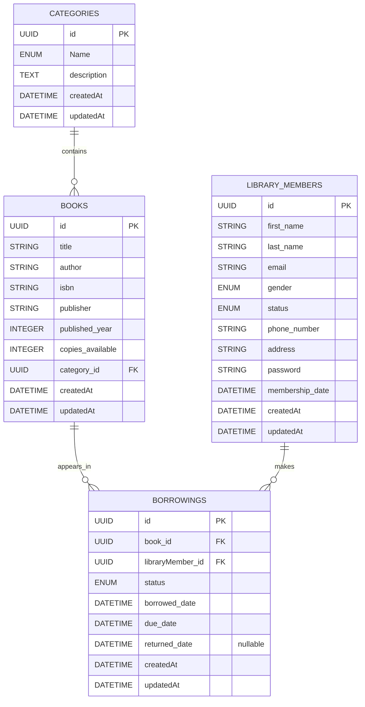

# Library Management System API

A REST API for managing library categories, books, members, and borrowing records. It is built with Node.js, Express, Sequelize, and MySQL.

## Features

- Manage library members: create, list, retrieve, update, and delete.
- Validate member names, email, password format, gender, phone number, and address.
- Set new members to `Active` and record their membership date.
- Manage books and their category, ISBN, publisher, publication year, and available copy count.
- Check book availability and increase or decrease available copies.
- Create borrowing records for existing books and members, with a future due date.
- Prevent borrowing when no copies are available and adjust the available copy count when borrowing or returning a book.
- Validate borrowing IDs, due dates, and status values.
- Use Sequelize migrations to create and update the MySQL schema.

## Technology

- Node.js and Express
- Sequelize ORM and Sequelize CLI
- MySQL with `mysql2`
- Joi request validation

## Setup

1. Clone the repository and install dependencies:

   ```bash
   git clone <repository-url>
   cd <repository-folder>
   npm install
   ```

2. Create a `.env` file in the project root:

   ```env
   PORT=3000
   DBHOST=your_database_host
   DBPORT=your_database_port
   DBUSER=your_database_user
   DBPASSWORD=your_database_password
   DBNAME=your_database_name
   ```

   Keep real credentials out of Git; `.env` is ignored by `.gitignore`.

3. Create the configured database if it does not already exist, then run the migrations:

   ```bash
   npm run create
   npm run migrate
   ```

4. Start the API:

   ```bash
   npm start
   ```

   For development with Nodemon, use `npm run dev`.

The server reports whether it connected to the database and which port it is listening on.

## API Routes

The routers are currently mounted at the application root; the paths below do not have a shared `/api` prefix. Send JSON requests with `Content-Type: application/json`.

### Library members

| Method | Path | Purpose |
| --- | --- | --- |
| POST | `/createMember` | Create a member |
| GET | `/allMembers` | List members |
| GET | `/get/:id` | Get one member |
| PUT | `/update/:id` | Update a member |
| DELETE | `/delete/:id` | Delete a member |

Member request fields use `first_name`, `last_name`, `email`, `gender`, `phone_number`, `password`, and `address`. `gender` must be `Male` or `Female`. New members receive the default `Active` status and the server sets `membership_date`.

### Categories

| Method | Path | Purpose |
| --- | --- | --- |
| POST | `/create` | Create a category |
| GET | `/getOne/:id` | Get one category |
| PUT | `/update/:id` | Update a category |

Category creation and update use `Name` (capital `N`) and `description`. `Name` must be one of `Thriller`, `Horror`, `Biography`, `Drama`, `Sci-Fi`, `Comedy`, `True Crime`, `Cookbooks`, or `Romance`.

### Books

| Method | Path | Purpose |
| --- | --- | --- |
| POST | `/books` | Create a book |
| GET | `/books` | List books |
| GET | `/books/:id` | Get one book |
| PUT | `/books/:id` | Update a book |
| DELETE | `/books/:id` | Delete a book |
| GET | `/books/:id/availability` | Check available copies |
| PUT | `/books/:id/increase` | Increase available copies |
| PUT | `/books/:id/decrease` | Decrease available copies |

Book creation requires `title`, `author`, `isbn`, `publisher`, `published_year`, `copies_available`, and `category_id`. `category_id` must be the UUID of an existing category.

### Borrowings

| Method | Path | Purpose |
| --- | --- | --- |
| POST | `/createBorrowing` | Borrow an available book |
| GET | `/allBorrowings` | List borrowing records |
| GET | `/:id` | Get one borrowing record |
| PUT | `/:id` | Update borrowing status or dates |
| DELETE | `/:id` | Delete a borrowing record |

Creating a borrowing requires `book_id`, `libraryMember_id`, and a future `due_date`. The API sets the initial status to `Borrowed`. Updating a record to `Returned` adds a copy back to the book's available count.

## Data relationships

- A category has many books; each book belongs to one category.
- A book has many borrowing records; each borrowing record refers to one book.
- A library member has many borrowing records; each borrowing record refers to one member.



## Contributors

Credits below are based on the contributors shown in the Git history:

- **Naomi Udoma (`Naomiudoma04`)** — initial project and schema setup, library member management and validation, category management, and borrowing validation.
- **Bright Imosemi (`Brightimosemi`)** — book controller, routes, and related model updates.
- **Ugonna Chidubem (`chidubem-dev`)** — borrowing workflow and borrowing controller features.

## Notes

- The project is still under development.
- The `npm test` script is currently a placeholder; endpoint checks can be made with an API client such as Postman.
- The member and category routers both declare `PUT /update/:id`, and the member router is mounted first. This route overlap should be resolved before relying on category updates.
- The category `GET /getOne/:id` handler currently needs a controller fix before it can reliably retrieve a category.
- Member passwords are validated but are currently stored and returned without hashing; do not use real member passwords with this version.
- Authentication and role-based authorization are not currently implemented.
